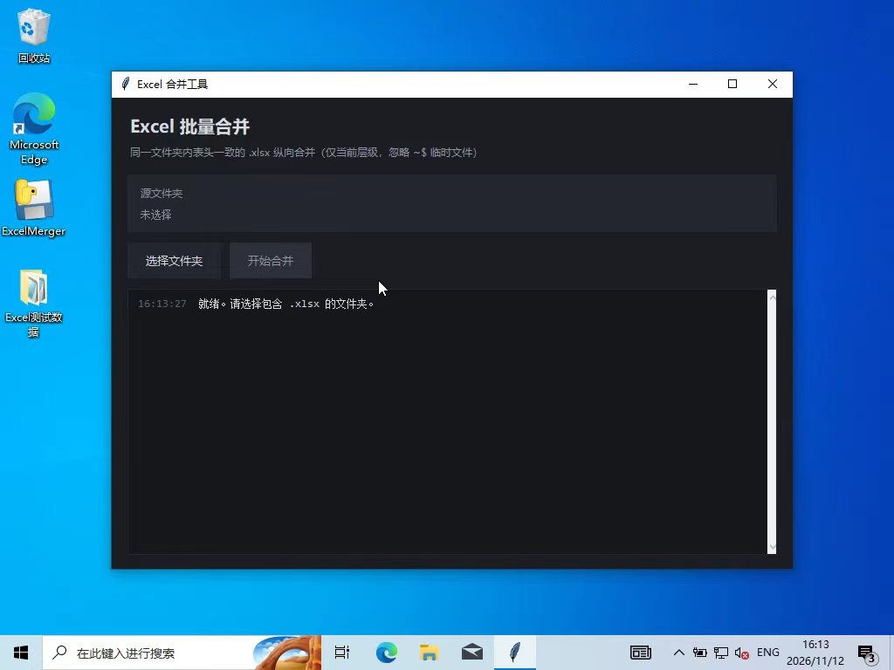
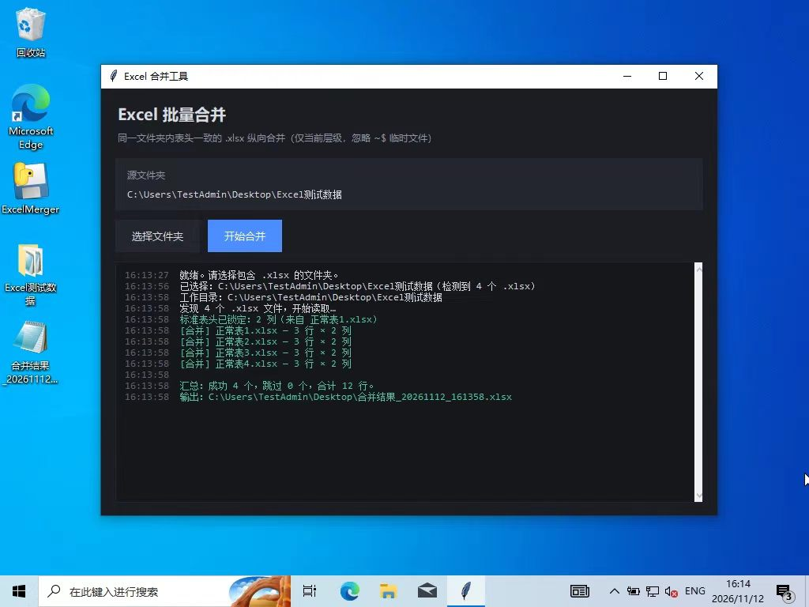
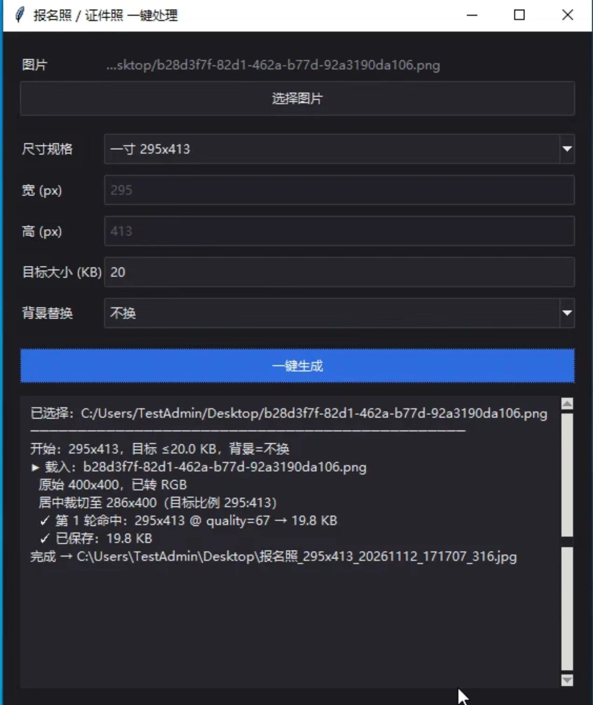
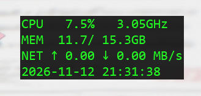

# 个人独立开发：Windows 效率工具箱
本项目为大一电子系新生的个人学习项目，使用 AI 辅助（Prompt Engineering）开发，包含两款 Windows 桌面工具原型。
## 包含工具
1. **Excel 批量合并助手**：基于 pandas，支持表头一致性校验、空行清理、异常跳过。
2. **证件照/报名照处理助手**：基于 Pillow，支持二分查找压缩、居中裁剪、纯色背景替换。
3. **极客系统监控悬浮窗**：基于 psutil，无边框半透明桌面挂件，实时显示 CPU、内存与网速。
## 运行方式
1. 安装依赖：
`pip install -r requirements.txt`
2. 运行工具：
`python excel_merger.py`
`python photo_tool.py`
## 说明
- 纯本地运行，不上传第三方数据。
- 已在 VirtualBox 纯净 Win10 环境完成基础打包与异常测试。
- 代码仅供学习交流，禁止转售本代码或打包程序；依赖库遵循其原始许可证。
## 软件截图

